# window_frame

A custom window frame for **Flutter Windows desktop** apps: replace the grey Windows
title bar with your own Flutter widgets (logo, title, tabs, menus, buttons), and keep
everything the user expects from a real Windows window.

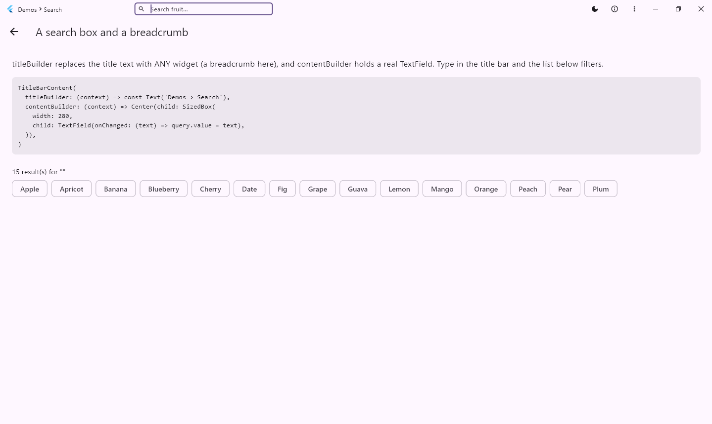

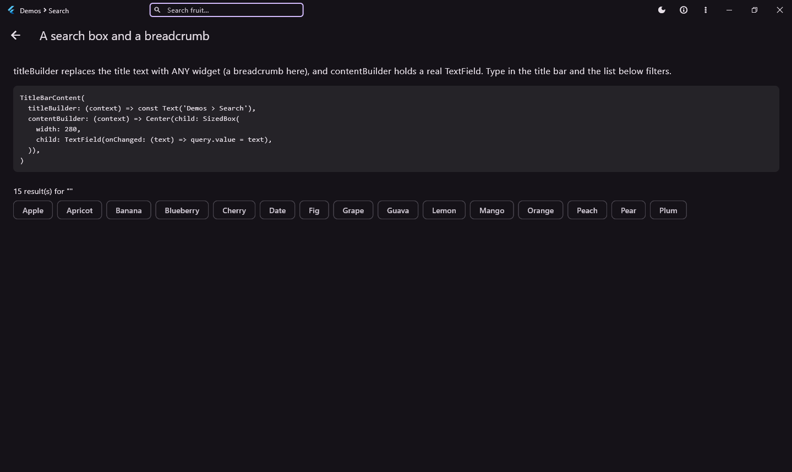

> **Status: 0.0.1, the first release.** Windows desktop only. Run the example before
> relying on it, and open an issue if something behaves differently from a native window.

## Why this package

- **Everything native stays native.** Resize borders, Aero Snap (drag to the screen
  edge), the window shadow, the minimize/maximize animations: all still the real
  Windows behavior. Only the title bar is yours.
- **No runner edits.** You do not touch `windows/runner`. Add the package and write Dart.
- **Your widgets work normally** inside the bar: `Tooltip`, `PopupMenuButton`,
  `DropdownButton`, `showDialog`, text fields...
- **Each page can have its own bar,** and you can change any bar at any time from
  anywhere (a page, a Bloc, a service).
- **Looks like Windows:** the bar and the caption buttons fade when the window loses the
  focus; light and dark themes work with no setup.
- **Behaves like a real title bar:** drag an empty part to move the window,
  double-click it to maximize, right-click it for the window menu. Buttons, tabs and
  text fields you put in the bar are left alone: no accidental maximize, no delay.
- **Window menus:** click the app icon (left or right button) or right-click the bar:
  the standard Restore / Minimize / Maximize / Close menu opens, and you can change its
  entries or turn it off.
- **Safe closing:** ask "Save your work?" before the window closes, whatever the way
  of closing (✕, Alt+F4, taskbar).
- **Right-to-left friendly:** your widgets follow the app's direction (Arabic),
  while the caption buttons stay on the right like in every Windows app.

Requires a Flutter version that ships Dart 3.11.5 or newer (see `environment` in `pubspec.yaml`). Windows only: on other platforms the calls do
nothing and your app runs normally.

---

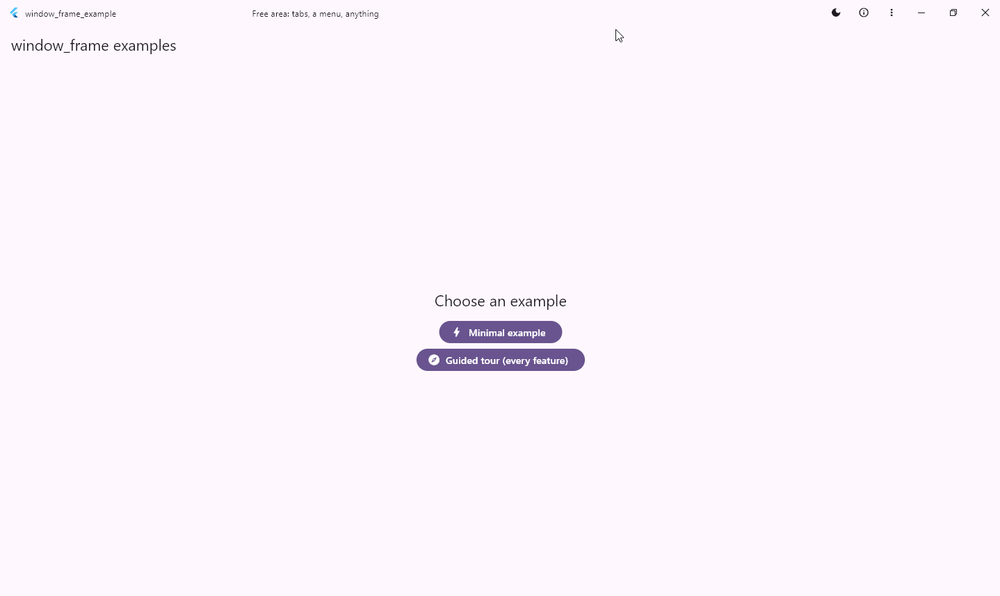

## Quick start (3 steps)

**1. Add the package** (`pubspec.yaml`):

```yaml
dependencies:
  window_frame: ^0.0.1
```

**2. Initialize it in `main()`**, before `runApp`:

```dart
import 'package:flutter/material.dart';
import 'package:window_frame/window_frame.dart';

Future<void> main() async {
  WidgetsFlutterBinding.ensureInitialized();
  await WindowFrame.init(const WindowFrameOptions(
    minimumSize: Size(800, 600), // optional (this is the default)
    startMaximized: true,        // optional (default: false)
  ));
  runApp(const MyApp());
}
```

**3. Wrap your app** with `WindowFrameScope` in `MaterialApp.builder`:

```dart
MaterialApp(
  builder: (context, child) => WindowFrameScope(
    child: child!,
  ),
  home: const HomePage(),
)
```

Run it. You now have a custom title bar showing your **project name**, with the three
caption buttons. That is all that is required; the rest of this guide is about making
the bar yours.

---

## How it works (read this once, everything else gets easy)

There are only three ideas:

1. **`WindowFrameScope`** puts the title bar on top of your app. You add it once.
2. **A `TitleBarController`** is the "remote control" of the title bar: it holds *what
   the bar shows* (title, logo, actions...). Change the controller, and the bar updates.
3. **`TitleBarContent`** is the list of things a controller describes. **Every field is
   optional. A field you leave empty (`null`) means "use the default bar's value".**
   So a page only says what is *different*.

```
 default controller          page controller          what the bar shows on that page
 ───────────────────         ────────────────         ───────────────────────────────
 title:   "My app"           title: "Invoice 105"     title:   "Invoice 105"   ← page wins
 leading: logo               (nothing)                leading: logo            ← inherited
 actions: [search, ⚙]        (nothing)                actions: [search, ⚙]     ← inherited
```

---

## The title bar

```
[leading] [title] [content ............] [actions] [caption buttons]
```

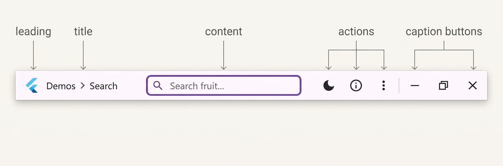

| Slot | What it is | Typical use |
|---|---|---|
| `leading` | always on the far left | app logo |
| `title` | text next to the logo | app name |
| `content` | fills **all the free space** | tabs, search box, menu bar |
| `actions` | right before the caption buttons | settings, theme toggle, profile |
| caption buttons | minimize / maximize / close | set on `WindowFrameScope` |

Everything left of the actions is a **drag area**. It behaves like the title bar of a
native window:

| The user... | On an empty part or a text | On a button, tab or text field |
|---|---|---|
| drags | the window moves | nothing: the control keeps the mouse, the window stays |
| double-clicks | the window maximizes / restores | nothing special; the control is never delayed |
| right-clicks | the bar menu opens | nothing special |

**What counts as a control?** Any widget that listens to the mouse: buttons, tabs
(`InkWell`), `GestureDetector`, text fields, a `Listener`, or anything that asks for a
special mouse cursor. They are detected automatically, so pressing them never moves the
window and a double-click on them never maximizes it. The tap itself is never delayed.

**What counts as empty space?** Everything else: gaps, texts, icons without `onPressed`,
and widgets that only draw something, such as a **progress bar** or an image. To keep such a
widget out of the drag area, wrap it in a `WindowNoDragArea` (see
[Keep a widget out of the drag area](#keep-a-widget-out-of-the-drag-area)).

### Create the default controller

Create it **once** (a top-level variable, a field in a service...) and give it to the
scope. Because you keep a reference, you can change it from anywhere later.

```dart
final TitleBarController defaultTitleBarController = TitleBarController(
  initialContent: TitleBarContent(
    leadingBuilder: (context) => const FlutterLogo(size: 16),
    // title: not set -> the application name (your project name) is shown.
    contentBuilder: (context) => const Center(child: Text('Free area')),
    actionBuilders: [
      (context) => IconButton(
            icon: const Icon(Icons.settings),
            onPressed: () => showDialog<void>(
              context: context,
              builder: (_) => const AlertDialog(title: Text('Settings')),
            ),
          ),
    ],
  ),
);

// in MaterialApp:
builder: (context, child) => WindowFrameScope(
  titleBarController: defaultTitleBarController,
  titleBarHeight: 36, // the one place where the height is set
  child: child!,
),
```

### Why `(context) => ...`? (the builders)

Slots such as `leadingBuilder` take a **function** that returns a widget, not a ready
widget. The function receives a `context` that lives **inside the window's Navigator**.
That is what makes `showDialog`, `Tooltip` and menus work from inside the bar.

You almost never think about it: write `(context) => MyWidget()`, or `(_) => ...` when
you do not need the context. The only time it matters is a closure that needs the
context right there:

```dart
// context comes from the builder: showDialog works
actionBuilders: [
  (context) => TextButton(
        onPressed: () => showDialog(context: context, builder: ...),
        child: const Text('Help'),
      ),
],
```

### Application name (the default title)

`WindowFrame.applicationTitle` is your **project name** from `pubspec.yaml`
(for example `my_app`). A bar with no `title` shows it automatically. You can:

```dart
TitleBarContent()                              // shows "my_app"  (default)
TitleBarContent(title: 'Invoices Pro')         // shows your own text
TitleBarContent(title: '')                     // shows no title at all
TitleBarContent(title: WindowFrame.applicationTitle) // explicit, same as the default
```

How it is found: Flutter does not ship `pubspec.yaml` inside the app, so the package
reads the title that the Windows runner gave to the window. `flutter create` writes your
project name there, in `windows/runner/main.cpp`:

```cpp
if (!window.Create(L"my_app", origin, size)) {
```

It is plain compiled code, so it works the same in debug and **release** builds.
Want a prettier name such as "My App"? Change that line: the title bar and the Windows
taskbar both use it. Names in any language work (Arabic, Chinese...).

### Change the bar at any time

```dart
defaultTitleBarController.setTitle('Invoices - unsaved *'); // just the title
defaultTitleBarController.update(TitleBarContent(           // only these fields
  actionBuilders: [(context) => const Icon(Icons.warning)],
));
defaultTitleBarController.replace(TitleBarContent(title: 'Fresh start')); // everything
defaultTitleBarController.reset();                          // back to all defaults
```

| Method | What it does |
|---|---|
| `setTitle(text)` | changes only the title |
| `update(changes)` | changes only the fields you set, keeps the others |
| `replace(content)` | replaces everything (unset fields fall back to defaults) |
| `reset()` | "inherit everything" |

### All `TitleBarContent` fields

| Field | Meaning |
|---|---|
| `leadingBuilder` | widget on the far left |
| `title` / `titleBuilder` / `titleStyle` | the title as text, or as any widget, and its style |
| `contentBuilder` | widget filling the free space |
| `actionBuilders` | widgets before the caption buttons. `[]` removes the inherited actions |
| `backgroundColor` / `foregroundColor` | colors while the window is active. Default: the theme |
| `inactiveBackgroundColor` / `inactiveForegroundColor` | colors while another window has the focus. Default: derived |
| `dimWhenInactive` | `false` keeps the bar identical when the window loses the focus |
| `appearanceTransitionDuration` | how fast the active/inactive change animates |
| `padding` / `spacing` | space around the drag area / between the logo and the title |
| `leadingMenu` | the menu that opens when the leading widget is clicked. `WindowMenu.disabled()` turns it off |
| `barMenu` | the menu that opens on a right-click of an empty part of the bar. `WindowMenu.disabled()` turns it off |
| `isDraggable` | `false` makes the bar unable to move the window (default: it can) |
| `doubleClickMaximizes` | `false` stops a double-click on an empty part from maximizing / restoring (default: it does) |

---

## Window menus (icon menu and right-click menu)

Two menus exist, both on by default, both showing the standard Windows entries
(**Restore, Minimize, Maximize, Close**; the ones that do not apply are dimmed, for example
Maximize while the window is maximized):

| Menu | Opens when the user... |
|---|---|
| `leadingMenu` | clicks the **leading widget** (usually the app icon) with the **left or the right** button. It opens just under the icon |
| `barMenu` | **right-clicks an empty part** of the bar. It opens at the mouse |

Nothing to write to get them: put a `leadingBuilder` and you are done. To change them:

```dart
TitleBarContent(
  leadingBuilder: (context) => const FlutterLogo(size: 16),

  // Your entries first, then the standard ones.
  leadingMenu: WindowMenu(
    itemsBuilder: (context, systemEntries) => [
      WindowMenuItem(
        label: 'Settings',
        icon: Icons.settings,
        // These keys run the entry from anywhere in the app. The hint shown at the
        // right ("Ctrl+,") is made from them. Needs flutter/services.dart.
        activator: const SingleActivator(LogicalKeyboardKey.comma, control: true),
        onPressed: () => openSettings(),
      ),
      const WindowMenuDivider(),
      ...systemEntries,              // Restore, Minimize, Maximize, Close
    ],
  ),

  // No right-click menu at all.
  barMenu: const WindowMenu.disabled(),
)
```

* **Double-click the icon** and the window closes, like a native window (the close goes
  through `onCloseRequested`). Turn it off with `WindowMenu(closeOnDoubleClick: false)`; the
  icon menu stays.
* **Right-click somewhere else while a menu is open** (even on the menu itself, which opens at
  the mouse): the old menu closes and the new one opens there, in the same click. A left-click elsewhere closes the menu and also reaches the widget under the mouse, so a button, a tab or a text field you click gets the press (or the focus) at once.
* The menu opens with a short fade (about 0.1 s) and moves back inside the window when you
  open it near an edge. `Esc` closes it.
* `systemEntries` is the standard list. Keep it, add around it, filter it, or ignore it and
  return only your own entries (for example in another language).
* `WindowMenuItem(icon: Icons.settings)` shows a Material icon; `iconBuilder` shows any widget
  (for example a `WindowCaptionGlyphIcon`).
* `WindowMenuItem(mnemonic: 'S')` chooses the letter that runs the entry from the keyboard
  **while the menu is open** (default: the first letter of the label).
* `WindowMenuItem(activator: ...)` makes keys run the entry **from anywhere, with the menu
  closed** (see "Keyboard shortcuts for menu entries" below). `shortcut: 'Alt+F4'` is only a
  hint text and binds nothing.
* `WindowMenuItem(isEnabled: false)` shows a dimmed entry. `WindowMenuDivider()` draws a line.
* The `context` you receive belongs to the window, so `showDialog` works in `onPressed`.
* Like every other field, a page controller that leaves `leadingMenu` or `barMenu` empty
  inherits the default bar's menu.


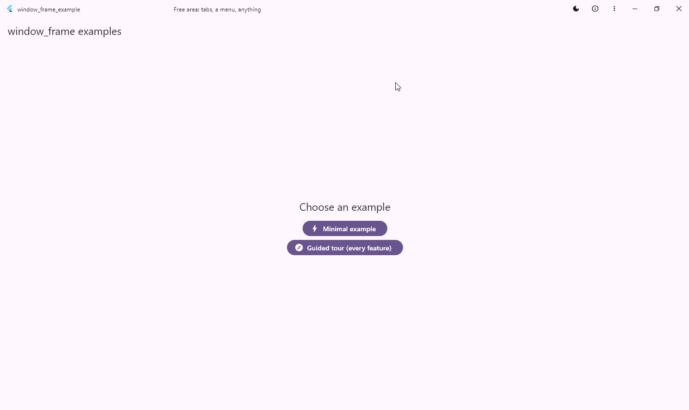


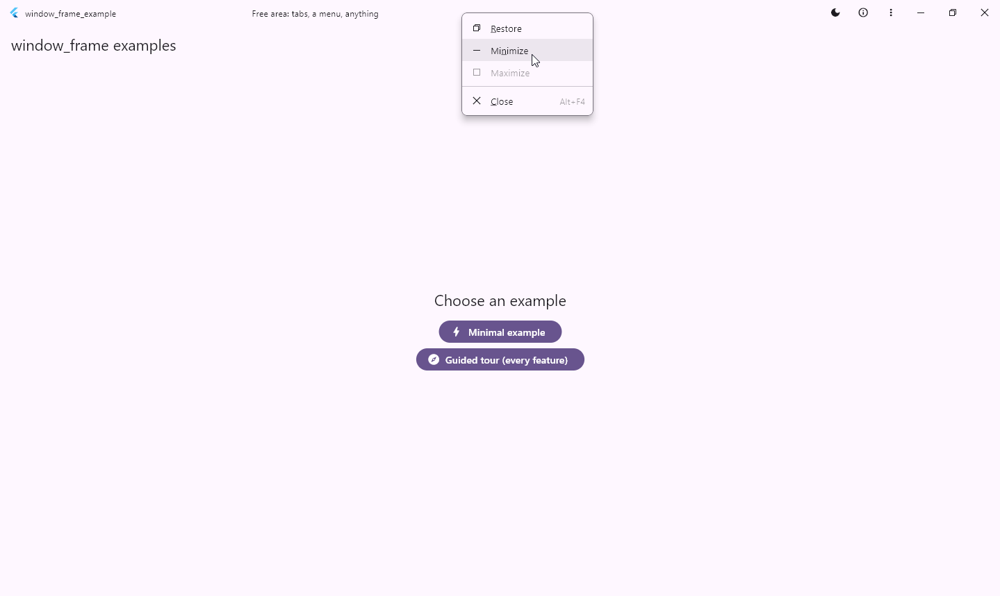
### Keyboard shortcuts for menu entries

Give an entry an `activator` and its keys work from anywhere in the app, with the menu closed.
The text shown at the right of the entry (`Ctrl+,`) is made from the activator, so the hint and
the behavior can never disagree:

```dart
import 'package:flutter/services.dart'; // LogicalKeyboardKey

WindowMenuItem(
  label: 'Settings',
  activator: const SingleActivator(LogicalKeyboardKey.comma, control: true),
  onPressed: openSettings,
)
```

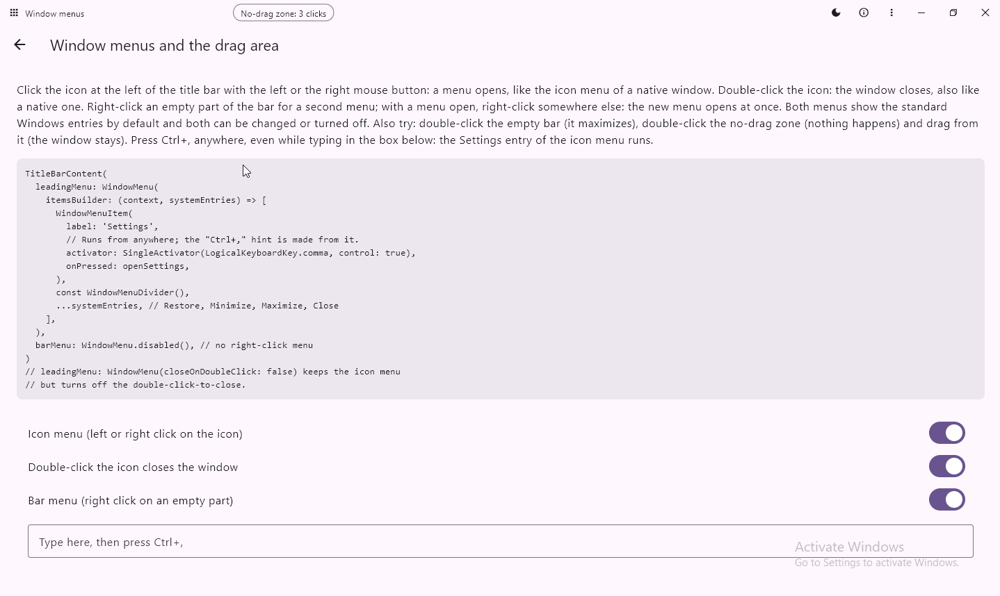

The rules, all chosen to behave like the accelerators of a native menu:

* It works while the entry belongs to the `leadingMenu` or the `barMenu` of the bar that is
  showing (a page's own bar brings its own shortcuts), and only while the entry is enabled.
  Entries are asked for **at the moment the key is pressed**, so `isEnabled` and `onPressed` are
  always current.
* It needs `Ctrl`, `Alt` or `Win`, or a key that types nothing (`F5`, `Esc`...). A plain letter
  would fight with typing, so it is ignored on purpose.
* The widget that has the focus gets the key first: a text field keeps `Ctrl+C`, `Ctrl+Z`...
  Your shortcut runs only when nothing below wanted the key.
* It does nothing while a window menu is open (use the mnemonic letters there) or while a
  dialog covers the window.
* `shortcut: 'text'` still works as a plain hint and wins over the generated text when you set
  both (for example to write `Ctrl + comma`). It binds nothing.
* Not a registry of app-wide shortcuts. Shortcuts that are not menu entries belong to your app:
  use Flutter's `Shortcuts` / `Actions` or `CallbackShortcuts` around your pages. Only entries
  that are shown in the title bar's menus are bound here.

### Everything the title bar and its menus do

This is the full behavior, matched to a native Windows title bar:

| The user... | Result |
|---|---|
| drags an empty part of the bar | the window moves (from a maximized window it restores and follows the mouse; snapping to the screen edges works) |
| double-clicks an empty part | maximize / restore |
| right-clicks an empty part | the bar menu opens at the mouse |
| right-clicks the icon | the icon menu opens under it |
| double-clicks the icon | the window closes (through `onCloseRequested`) |
| presses the icon (left button) | the icon menu opens at once, on the press. Keep the button down and **drag**: the menu follows the mouse and **releasing over an entry runs it**; releasing over the icon or the menu leaves it open (a plain click), anywhere else closes it |
| presses a button, tab or text field in the bar | that control gets the mouse; the window never moves or maximizes |
| left-clicks a widget (a button, a tab, a text field) while a menu is open | the menu closes **and** the widget gets the click (it is pressed, or takes the focus) |
| left-clicks an empty part of the bar while a menu is open | the menu closes; the click counts as the first click of a double-click |
| double-clicks an empty part while a menu is open | the menu closes and the window maximizes / restores |
| double-clicks the icon while its menu is open | the window closes |
| presses the icon (left, right, or press-and-drag) while another menu is open | that menu closes and the icon's menu opens at once, like switching between native menus |
| right-clicks somewhere else while a menu is open | the menu closes and the new place's menu opens, in one click |
| presses the empty bar and drags while a menu is open | the menu closes and the window moves |
| switches to another window, or the window is maximized / restored | an open menu closes by itself |
| presses `Esc` with a menu open | the menu closes |
| presses `↓` / `↑` / `Home` / `End` in a menu | the highlight moves (the mouse and the keyboard share one highlight) |
| presses `Enter` or `Space` in a menu | the highlighted entry runs |
| presses the `activator` of an enabled menu entry, anywhere in the app | the entry runs, with the menu closed |
| presses that shortcut while a menu is open, or while a dialog covers the window | nothing |
| types a letter in a menu | the entry with that letter runs (`R`estore, mi`N`imize, ma`X`imize, `C`lose, like Windows); if several entries share it, the highlight moves through them. Set `WindowMenuItem(mnemonic: 'S')` to choose the letter; the letter is underlined in the entry |

**Not included** (they need native code or more work): `Alt+Space` to open the menu from the
keyboard, system-wide hotkeys that work while the window is not focused, a registry of app-wide
shortcuts that are not menu entries (use Flutter's `Shortcuts`), the Windows 11 Snap Layouts popup on the maximize button, and the *Move* and *Size*
entries of the system menu.

### Keep a widget out of the drag area

You do not need this for buttons, tabs, icons with `onPressed`, text fields or a `Listener`:
they are controls and are detected automatically. Use `WindowNoDragArea` for a widget that
only **draws** something and should not act like empty space: a progress bar, a status
chip, an image.

```dart
contentBuilder: (context) => Center(
  child: WindowNoDragArea(
    child: SizedBox(width: 220, child: LinearProgressIndicator(value: progress)),
  ),
),
```

Inside a `WindowNoDragArea`: pressing never moves the window, a double-click never
maximizes it, and a right-click never opens the bar menu.

---

## A different title bar per page

Give a page its own controller. **It only describes what differs** from the default bar.

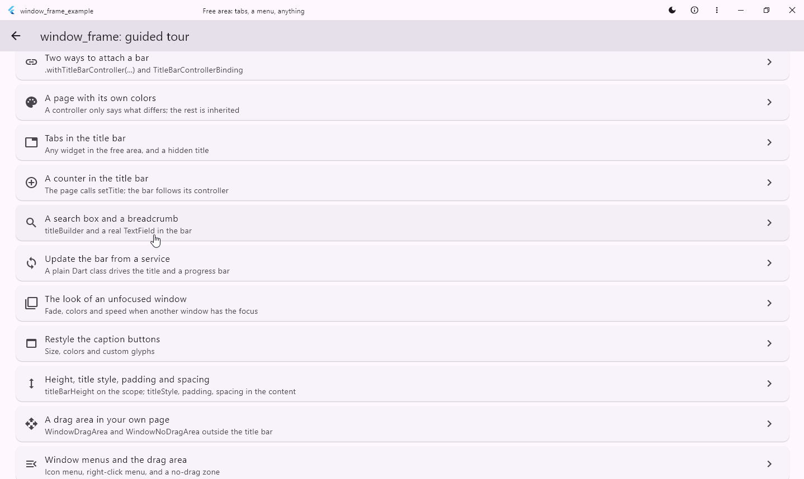

```dart
final invoiceTitleBarController = TitleBarController(
  initialContent: TitleBarContent(title: 'Invoice 105'),
);

class InvoicePage extends StatelessWidget {
  const InvoicePage({super.key});

  @override
  Widget build(BuildContext context) {
    return Scaffold(/* ... */).withTitleBarController(invoiceTitleBarController);
  }
}
```

There are **two equivalent ways** to attach a controller to a page. Pick the one you like:

```dart
// Style 1: extension. Short; good for small pages.
Scaffold(/* ... */).withTitleBarController(invoiceTitleBarController)

// Style 2: wrapper widget. The controller is visible at the TOP of the page,
// which is easier to spot in a long page.
TitleBarControllerBinding(
  controller: invoiceTitleBarController,
  child: Scaffold(/* ... */),
)
```

- When the page opens, the bar changes. When the page is covered by another page or
  popped, the previous bar **comes back automatically**.
- The most recently opened page wins ("the top page wins").
- Change it live: `invoiceTitleBarController.setTitle('Invoice 105 - unsaved')`.
- Remove the inherited actions on one page: `TitleBarContent(actionBuilders: [])`.

Where do you create page controllers? Anywhere that lives as long as you need: a
top-level variable, a field of a service, a Bloc... Dispose the ones you create when
you no longer need them (`controller.dispose()`).

---

## Inactive window look

When the user clicks another window, the bar and the caption buttons fade, like native
Windows bars: text and icons become paler and the background shifts slightly. It is on
by default.

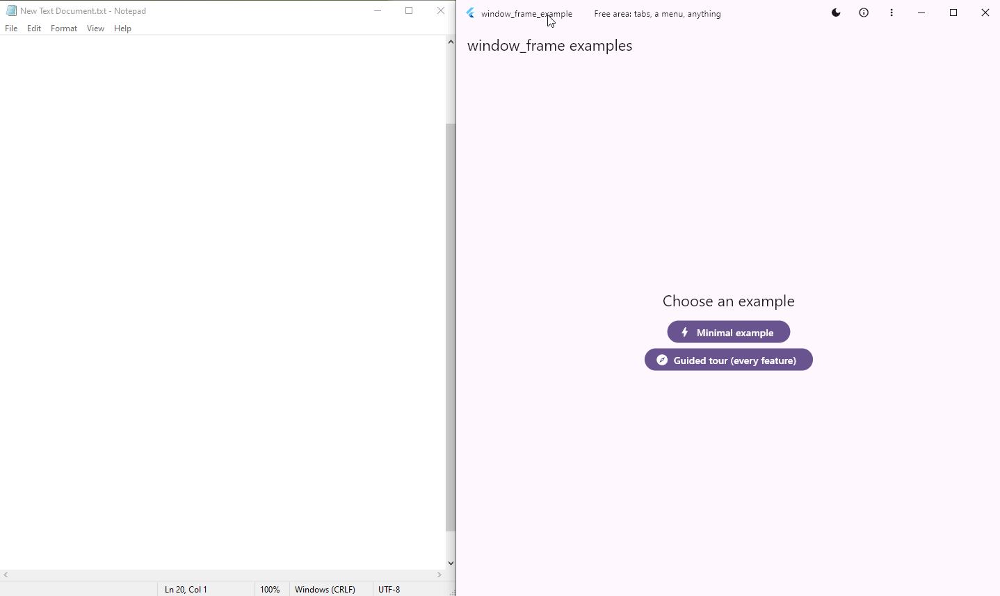

```dart
TitleBarContent(dimWhenInactive: false)                       // turn it off
TitleBarContent(inactiveForegroundColor: Colors.grey)         // choose the colors
TitleBarContent(appearanceTransitionDuration: Duration.zero)  // no animation
```

React to it in your own widgets:

```dart
ValueListenableBuilder<bool>(
  valueListenable: WindowFrame.isWindowActive,
  builder: (context, isActive, _) => Opacity(opacity: isActive ? 1 : 0.6, child: ...),
)
```

---

## Caption buttons (minimize, maximize, close)


They are drawn with `CustomPaint` (the Windows glyphs), adapt to light/dark themes and to
the inactive look, and need no setup. To restyle them:

```dart
WindowFrameScope(
  captionButtons: WindowCaptionButtons(
    style: WindowCaptionButtonsStyle(
      buttonWidth: 50,
      iconStrokeWidth: 1.2,
      closeHoverColor: Colors.deepOrange,
    ),
    // Replace one glyph with ANY widget:
    closeIcon: (context, color) => Icon(Icons.close, size: 14, color: color),
  ),
  child: child!,
)
```

| `WindowCaptionButtonsStyle` | Default |
|---|---|
| `buttonWidth` | 46 |
| `iconSize` / `iconStrokeWidth` | 10 / 1 |
| `iconColor`, `inactiveIconColor` | follow the title bar text color |
| `hoverColor`, `pressedColor` | the icon color at 10% / 20% |
| `closeHoverColor`, `closePressedColor`, `closeHoverIconColor` | Windows red, light red, white |

Replaceable glyphs: `minimizeIcon`, `maximizeIcon`, `restoreIcon`, `closeIcon`.

Hide the buttons a window should not offer: `WindowCaptionButtons(showMinimize: false,
showMaximize: false)` leaves only the close button (like a dialog).

### The glyphs are public: use them anywhere

The four pictures drawn on the caption buttons are a normal widget, so you can reuse them
in your own UI (the standard window menu uses them too):

```dart
WindowCaptionGlyphIcon(glyph: WindowCaptionGlyph.restore, size: 12, color: Colors.teal)

// in a menu entry, instead of an IconData:
WindowMenuItem(
  label: 'Minimize',
  iconBuilder: (context, color) =>
      WindowCaptionGlyphIcon(glyph: WindowCaptionGlyph.minimize, color: color),
  onPressed: WindowFrame.minimize,
)
```

`WindowCaptionGlyph` has `minimize`, `maximize`, `restore` and `close`. `WindowCaptionGlyphPainter`
is the `CustomPainter` itself, if you prefer to paint with your own `CustomPaint`.
The same buttons are used on every page. Need a fully custom set? Build it with
`WindowCaptionButton`.

---

## Ask before closing (`onCloseRequested`)

Runs for **every** way of closing: the ✕ button, Alt+F4, the taskbar, and
`WindowFrame.close()`.

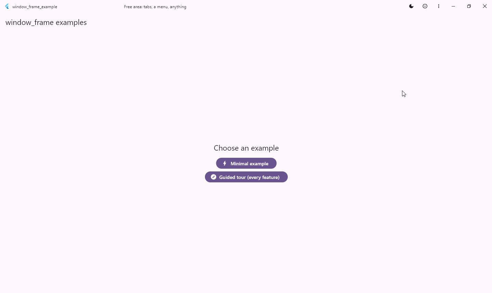

```dart
WindowFrameScope(
  onCloseRequested: (context) async {
    final ok = await showDialog<bool>(
      context: context, // centered on the window
      builder: (dialogContext) => AlertDialog(
        title: const Text('Close the app?'),
        actions: [
          TextButton(
            onPressed: () => Navigator.pop(dialogContext, false),
            child: const Text('Cancel'),
          ),
          FilledButton(
            onPressed: () => Navigator.pop(dialogContext, true),
            child: const Text('Close'),
          ),
        ],
      ),
    );
    return ok ?? false; // true = close, false = stay open
  },
  child: child!,
)
```

You can also save files or show a progress dialog first: the window closes when your
function returns `true`. A repeated close request while your dialog is open is ignored.
If your function throws, the window closes (the user is never trapped).

---

## Window commands and state

| Call | What it does |
|---|---|
| `await WindowFrame.init([options])` | Startup configuration. Call once, before `runApp()` |
| `WindowFrame.minimize()` · `maximize()` · `restore()` · `toggleMaximize()` | Window state |
| `WindowFrame.close()` | Ask to close (goes through `onCloseRequested`) |
| `WindowFrame.startDrag()` | Start moving the window (the bar uses it) |
| `WindowFrame.setMinimumSize(Size)` | Change the minimum size at runtime (also enlarges a smaller window) |
| `WindowFrame.applicationTitle` | `String`: the project name (see above) |
| `WindowFrame.isMaximized` | `ValueListenable<bool>` |
| `WindowFrame.isWindowActive` | `ValueListenable<bool>`, false while another window has the focus |
| `WindowFrame.frameActive` | `ValueListenable<bool>`, true once the native bar is removed |
| `WindowFrame.isSupported` | `bool`, true on Windows |

`WindowFrameOptions` (passed to `init`):

| Option | Default | Meaning |
|---|---|---|
| `minimumSize` | `Size(800, 600)` | The window cannot be made smaller. `Size.zero` disables the limit |
| `startMaximized` | `false` | Open maximized |
| `customFrame` | `true` | `false` keeps the standard Windows title bar |
| `frameBorderWidth` | `0` | Pixels of the native Windows frame (its thin border and shadow edge) extended into the app area on every side. `0` extends nothing, the cleanest look; `1` made the border look thicker on the machine where this was tested. Kept between 0 and 16 |

`init` never throws: if the native side is missing, the standard Windows frame simply
stays and your app still works. The minimum size is not applied while the window is
maximized.

---

## Right-to-left (Arabic)

Nothing to do. Your widgets in the bar follow the app's `Directionality`
(for example right-to-left), while the bar's own layout and the caption buttons stay on
the right, as in every Windows app.

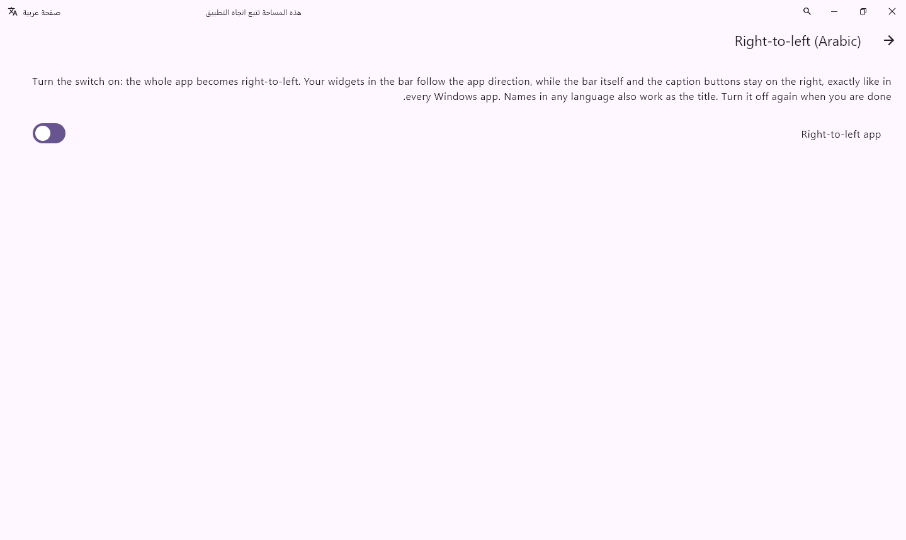

---

## Cookbook (copy, paste, change)

Every recipe below is a working demo in the [example app](example/lib/demos). Run the
example and open the demo to see it live.

### A page with its own colors
```dart
final coloredController = TitleBarController(
  initialContent: const TitleBarContent(
    title: 'Colored bar',
    backgroundColor: Color(0xFF00796B),
    foregroundColor: Colors.white,
  ),
);
// Logo, free area and actions are inherited from the default bar.
```

### Tabs inside the title bar
```dart
TitleBarContent(
  title: '', // hide the title text
  contentBuilder: (context) => Row(
    crossAxisAlignment: CrossAxisAlignment.stretch,
    children: [for (final tab in tabs) MyTab(tab)],
  ),
)
```

### A search box and a breadcrumb
```dart
TitleBarContent(
  titleBuilder: (context) => const Text('Home > Search'), // any widget as title
  contentBuilder: (context) => Center(
    child: SizedBox(width: 280, height: 26, child: TextField(onChanged: search)),
  ),
)
```

### Drive the bar from a service, a Bloc or a timer

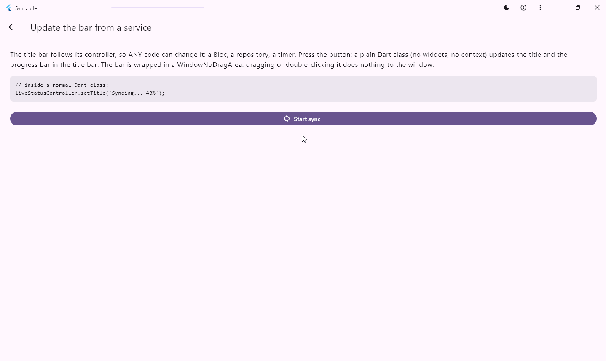
The bar follows its controller, so code with **no widgets and no context** can change it:
```dart
class SyncService {
  void onProgress(int percent) =>
      syncController.setTitle('Syncing... $percent%');
}
```

### Hide, rename or restore the default title
```dart
defaultTitleBarController.setTitle('Renamed');
defaultTitleBarController.setTitle('');                          // hide it
defaultTitleBarController.setTitle(WindowFrame.applicationTitle); // back to the name
```

### Change how the unfocused window looks
```dart
TitleBarContent(
  inactiveBackgroundColor: const Color(0xFF3E2723),
  inactiveForegroundColor: Colors.orangeAccent,
  appearanceTransitionDuration: const Duration(milliseconds: 800),
)
```

### Orange close button and a custom close icon
```dart
WindowFrameScope(
  captionButtons: WindowCaptionButtons(
    style: const WindowCaptionButtonsStyle(closeHoverColor: Colors.deepOrange),
    closeIcon: (context, color) => Icon(Icons.close_rounded, size: 16, color: color),
  ),
  child: child!,
)
```

### Add your own entries to the icon menu
```dart
leadingMenu: WindowMenu(
  itemsBuilder: (context, systemEntries) => [
    WindowMenuItem(label: 'About', onPressed: showAbout),
    const WindowMenuDivider(),
    ...systemEntries,
  ],
),
```

### A keyboard shortcut for a menu entry
```dart
leadingMenu: WindowMenu(
  itemsBuilder: (context, systemEntries) => [
    WindowMenuItem(
      label: 'Settings',
      // The menu shows "Ctrl+," and the keys work from anywhere in the app.
      activator: const SingleActivator(LogicalKeyboardKey.comma, control: true),
      onPressed: () => showDialog<void>(
        context: context,
        builder: (_) => const AlertDialog(title: Text('Settings')),
      ),
    ),
    const WindowMenuDivider(),
    ...systemEntries,
  ],
),
```

### A right-click menu in another language
```dart
barMenu: WindowMenu(
  itemsBuilder: (context, systemEntries) => [
    WindowMenuItem(label: 'تصغير', onPressed: WindowFrame.minimize),
    WindowMenuItem(label: 'إغلاق', onPressed: WindowFrame.close),
  ],
),
```

### Turn both menus off
```dart
TitleBarContent(leadingMenu: const WindowMenu.disabled(), barMenu: const WindowMenu.disabled())
```

### Switch the whole app to right-to-left
Wrap the scope in a `Directionality` (or set the locale). Your widgets in the bar follow
it; the caption buttons stay on the right.

---

## Try the example

```
cd example
flutter run -d windows
```

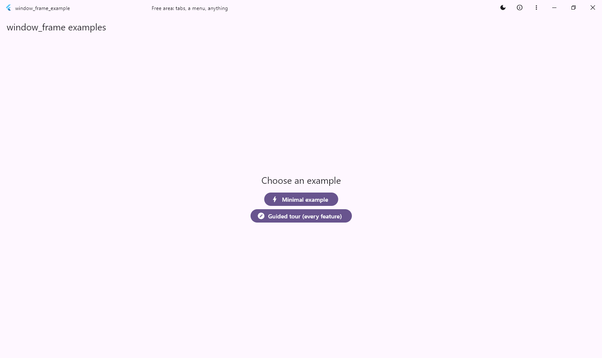

The example is one app with a normal `main.dart` (`WindowFrame.init` with the options, and
`WindowFrameScope` with the default controller in `MaterialApp.builder`). Its home page
offers two examples; both have a back arrow in the `AppBar`:

* **Minimal example** (`example/lib/simple_example_page.dart`): a page that selects its own
  controller. The controller says only one thing, `actionBuilders: []`, so the bar is the
  default one **without the action buttons**; everything else is inherited. About 30 lines.
* **Guided tour**: the home page below.

The guided tour's home page: it shows the live window state, the window commands, and
twelve demos (two ways to attach a bar, colors and `reset()`, a counter, tabs, search box, live updates from a
service, the unfocused look, caption buttons (styles, glyphs, a whole custom set), height / title style /
padding / spacing, a drag area in your own page, window menus with mnemonics and disabled entries,
right-to-left). Each demo explains itself on
screen and shows the code it uses.

---

## Troubleshooting

**"No Navigator / Overlay widget found" or `showDialog` fails in the bar.**
You used a context from *above* the bar, usually the `context` of `MaterialApp.builder`.
Use the `context` that the slot's builder gives you (see "Why `(context) => ...`").

**I still see the standard grey Windows title bar and not mine.** `WindowFrame.frameActive`
is false: the native side did not start (and then the package deliberately draws
nothing). Make sure `await WindowFrame.init()` runs before `runApp()`, that
`customFrame` is not `false`, and that you restarted the app completely after adding the
package (hot reload cannot load native code).

**The bar does not change when I call `setTitle`.** Check that you changed the same
controller object that you gave to `WindowFrameScope` or to `withTitleBarController`
(create each controller once, not inside `build`).

**My page's title bar disappeared while a dialog was open.** A dialog opened with
`useRootNavigator: false` is pushed on the same Navigator as your page, so the page is
no longer "the current one" and the default bar returns until the dialog closes. Use
the default `showDialog` (root Navigator), which keeps the page's bar.

**The title shows `my_app` and I want a nicer name.** Set `title: 'My App'`, or edit the
name in `windows/runner/main.cpp` (this also changes the taskbar text).

**`startMaximized` does nothing.** It works only if `WindowFrame.init` runs before the
first frame, i.e. before `runApp()`.

**Double-clicking or dragging my widget in the bar maximizes / moves the window.**
The widget only draws something (a progress bar, an image...), so it counts as empty space.
Wrap it in `WindowNoDragArea`.

**A shortcut is shown in the menu but pressing it does nothing.**
`shortcut: 'Ctrl+,'` is only a hint text. Use `activator: SingleActivator(...)` (it binds the
keys and writes the hint for you). If you did, check that: the entry is enabled; it belongs to
the `leadingMenu` or `barMenu` of the bar that is showing; the shortcut has `Ctrl`, `Alt` or
`Win` (a plain letter is ignored); no window menu is open and no dialog is on top; and the
focused widget does not use the same keys for itself.

**Clicking the icon opens a menu and I do not want it.**
Set `leadingMenu: const WindowMenu.disabled()` in your `TitleBarContent`. The same for the
right-click menu with `barMenu`.

**I changed C++ and nothing happened.** Stop the app and run it again. Hot reload and hot
restart do not rebuild native code.

---

## Things to know

- `WindowFrameScope` hosts your whole app inside its **own root `Navigator`**. This is
  what lets the bar use dialogs and menus.
- Dialogs from your pages (`showDialog` and friends) land in that Navigator by default,
  so the dialog **and its dim barrier cover the whole window, title bar included**.
- Do not call `Navigator.of(context, rootNavigator: true).push(page)` to open a full
  page: that Navigator only hosts your app. Use the normal `Navigator.of(context)`.
- Providers declared *inside* a page are not visible to the title bar. Providers above
  `MaterialApp` are.
- The app below the bar is clipped, so nothing in it (not even a page transition) can
  draw over the bar.

## Known limits

- Windows only. On other platforms the Dart API does nothing and `isSupported` is false.
- One window only.
- No Snap Layouts popup on the maximize button (Windows 11).
- `registrar->GetView()` is deprecated upstream; migrate to `GetViewById` when it is
  removed.

## Contributing

Read [ARCHITECTURE.md](ARCHITECTURE.md): it explains the layers, the design decisions, and
has a table "I want to change X → open file Y". Every change needs a `CHANGELOG.md` entry.

## License

BSD 3-Clause License. See [LICENSE](LICENSE).
